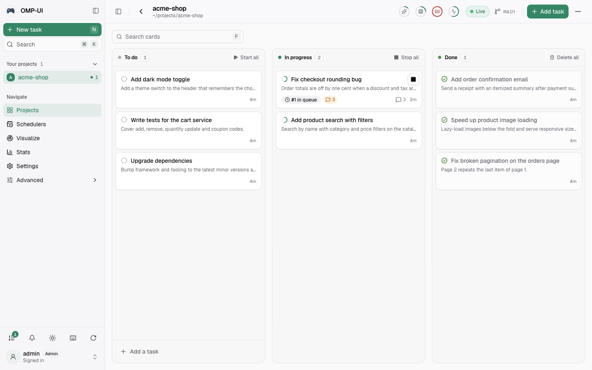
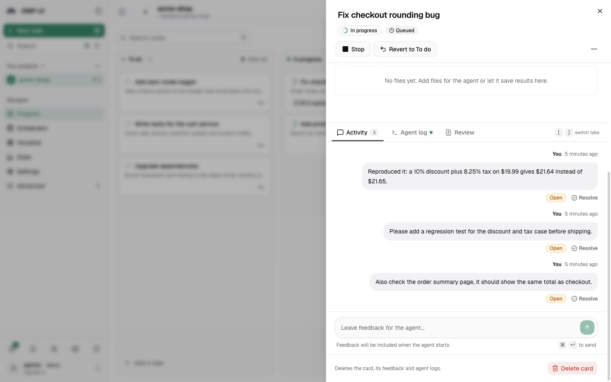
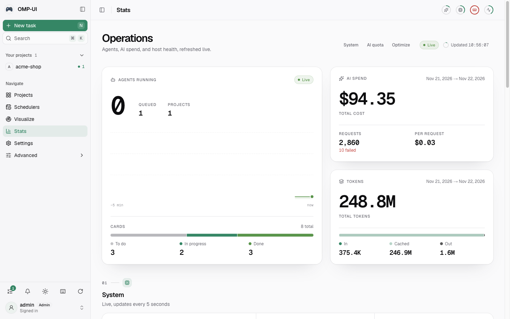
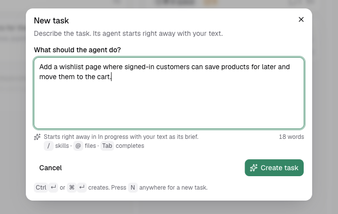
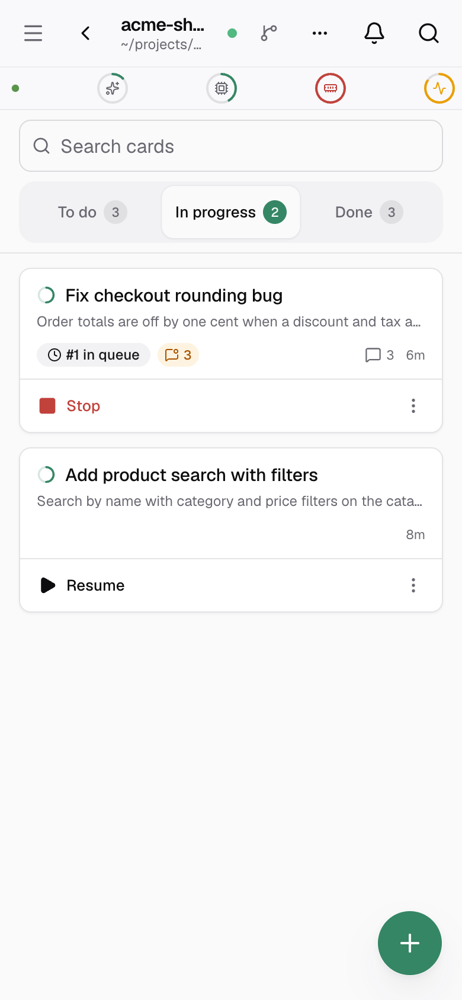

# OMP-UI

[](https://www.npmjs.com/package/omp-ui)
[](https://github.com/quangpl/omp-ui/actions/workflows/ci.yml)
[](LICENSE)
[](https://nodejs.org)

**OMP-UI is a self-hosted kanban web UI for [omp](https://omp.sh/docs) (oh-my-pi), the AI coding agent.** Manage work as cards on a kanban board, let an agent build each card in your repository, review it through comments and ship it as a pull request. Developer-friendly: CLI, REST API, keyboard shortcuts. Follow every run live from your desktop or phone.



## Features

- **Kanban board.** Cards move through To do, In progress and Done as agents work on them.
- **Standard delivery flow.** Each card follows plan, build, review, ship: describe the idea, an agent builds it, you review it through comments, then ship a reviewable increment as a PR or a push.
- **Developer-friendly.** Start with `npx omp-ui`, open pull requests (GitHub) or merge requests (GitLab), script it with the [REST API](docs/API.md) and drive the board with keyboard shortcuts.
- **Live view.** Watch agent output as it happens, on desktop or phone.
- **Schedulers and stats.** Recurring cards on a cron schedule, plus usage and cost stats.
- **Cluster mode.** Spread agent runs across several machines ([details](docs/CLUSTER.md)).
- **Self-hosted, MIT.** Runs on your machine with SQLite by default; Docker and pm2 supported.

## Screenshots


*The board: cards move through To do, In progress and Done as agents work on them.*



*Card detail: steer the agent with feedback comments and follow its run live.*



*Stats: running agents, AI spend, token usage and host health.*



*New task: describe the work in plain text and the agent starts right away.*



*Mobile: follow and steer your agents from a phone.*

## Requirements

- Node.js 24 or newer
- omp, installed and signed in:

```sh
curl -fsSL https://omp.sh/install | sh
omp            # run once and sign in to an AI provider
```

## Quick start

```sh
npx omp-ui
```

This one command sets everything up, starts OMP-UI in the background with pm2 and prints its URL. It asks for a password for the `admin` account, or generates one and prints it. Open the URL, sign in and follow the setup wizard.

To install it permanently:

```sh
npm i -g omp-ui
omp-ui
```

Or install a build straight from [GitHub Releases](https://github.com/quangpl/omp-ui/releases) (every push to `main` publishes one):

```sh
npm i -g https://github.com/quangpl/omp-ui/releases/latest/download/omp-ui.tgz   # latest release
npm i -g https://github.com/quangpl/omp-ui/releases/download/nightly/omp-ui.tgz  # latest main build
```

Settings and data live in `~/.omp-ui`. SQLite is the default database, so you don't need to set one up.

## Basic commands

| Command | What it does |
| --- | --- |
| `omp-ui` | Set up and start OMP-UI |
| `omp-ui status` | Check whether it is running and show its URL |
| `omp-ui stop` / `start` / `restart` | Stop, start or restart the server |
| `omp-ui logs -f` | Follow the server log |
| `omp-ui open` | Open OMP-UI in your browser |
| `omp-ui config set port 8080` | Change a setting (`port`, `data-dir`, `db-url`), then run `restart` |
| `omp-ui doctor` | Check Node.js, omp, git, gh and pm2 |
| `omp-ui update` | Update to the latest version and restart |
| `omp-ui help` | List every command |

## Using it

1. **Create a project.** Pick a folder or clone a Git repository.
2. **Add a card.** Describe the task in your own words, and an agent starts working on it.
3. **Give feedback.** Comment on the card. The agent reads your comments and keeps going.
4. **Ship it.** Click **Create PR**, **Push to main** or **Push to current branch**.

## Access from anywhere

OMP-UI runs commands on your machine. Before exposing it, set a strong admin password with `omp-ui passwd`.

### Tailscale (private, recommended)

Reach OMP-UI only from your own devices, over HTTPS:

```sh
tailscale serve --bg 3000
```

Open `https://<machine-name>.<tailnet>.ts.net` on any device in your tailnet. To share it with people outside your tailnet, use `tailscale funnel --bg 3000` instead.

### Cloudflare Tunnel

To get a temporary public link right away:

```sh
omp-ui public          # prints an https://….trycloudflare.com link
omp-ui public stop
```

The link changes every time it starts. For a permanent address on your own domain, create a [named Cloudflare Tunnel](https://developers.cloudflare.com/cloudflare-one/connections/connect-networks/) that points to `http://localhost:3000`.

If you use Tailscale, Cloudflare or another proxy, add `VINEXT_TRUST_PROXY=1` to `~/.omp-ui/.env`, then run `omp-ui restart`.

## Docker

```sh
docker compose up -d   # then open http://localhost:3000
```

## Learn more

- [Advanced guide](docs/ADVANCED.md): every feature, the full CLI, PM2, systemd, Docker, databases, clustering and configuration.
- [API reference](docs/API.md)
- [Cluster mode](docs/CLUSTER.md)
- [Changelog](CHANGELOG.md)
- [Security policy](SECURITY.md)

## Contributing

See [CONTRIBUTING.md](CONTRIBUTING.md) and the [Code of Conduct](CODE_OF_CONDUCT.md).

```sh
pnpm install
pnpm dev
pnpm test
```

## License

[MIT](LICENSE)
